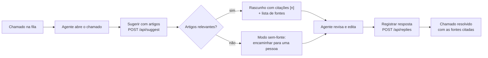
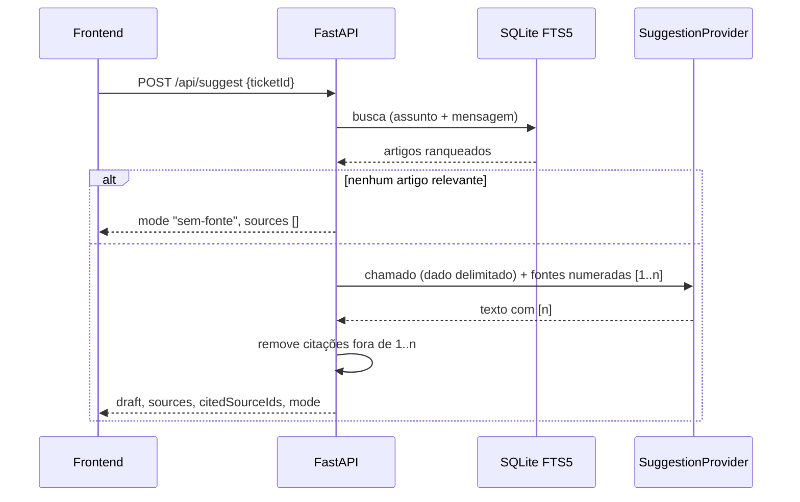

# ResolveAI

Central de atendimento com busca na base de conhecimento e sugestões de resposta ligadas às fontes consultadas. A sugestão é sempre um **rascunho**: o agente humano revisa, edita e só então registra a resposta.

- Fila de chamados com filtros, prioridade e status.
- Base de conhecimento editável, com histórico versionado de cada alteração.
- Busca full-text (SQLite FTS5 + BM25) insensível a acentos e caixa.
- Sugestões que só citam artigos efetivamente recuperados, com dois provedores: determinístico (padrão, sem chave) e OpenAI (opcional).
- API documentada em `/docs`, logs estruturados em JSON, headers de segurança, rate limit e imagem Docker pronta para produção.

## Fluxo do atendente



Nada é enviado ao cliente automaticamente: toda resposta de `/api/suggest` traz `needsReview: true`, e o registro exige uma ação explícita do agente.

## Como a busca funciona

1. **Normalização pt-BR** (`resolveai/search.py`): o texto da consulta é convertido para minúsculas e sem acentos (`Devolução` → `devolucao`). Palavras com menos de 3 letras e stopwords em português e inglês (`como`, `para`, `ainda`, `the`…) são descartadas. Consultas vazias ou só com stopwords não retornam nada.
2. **Índice FTS5**: a tabela virtual `articles_fts` usa o tokenizer `unicode61 remove_diacritics 2`, então o índice também ignora acentos e caixa. Triggers mantêm o índice sincronizado com `articles` em inserções, edições e exclusões.
3. **Radical simples**: cada termo vira uma busca por prefixo (`entregue` → `entreg*`, que casa com `entrega` e `entregador`). Os termos contêm apenas `[a-z0-9]` e vão entre aspas, então operadores do FTS5 digitados pelo cliente (`AND`, `NEAR`, `*`, `:`) não têm efeito.
4. **Ranking BM25** com pesos por coluna — título 4.0, categoria 1.5, corpo 1.0 — e desempate estável por `id`.
5. **Corte de relevância**: para sugestões, até 3 artigos são recuperados e os que ficam abaixo de 30% do score do melhor são descartados, evitando que correspondências incidentais virem fonte.

`GET /api/search?q=...` expõe o mesmo ranking (termos usados e score), útil para avaliar a base.

## Como a sugestão funciona e como as fontes são citadas



- As fontes recuperadas são numeradas `[1]..[n]` e só elas são entregues ao provedor.
- Depois da geração, `validate_citations` remove qualquer marcador `[k]` que não corresponda a uma fonte recuperada e calcula `citedSourceIds`. Um rascunho vazio após a validação é tratado como falha (502).
- No frontend, as fontes citadas no texto **atual** (após a edição do agente) aparecem destacadas; ao registrar, `sourceIds` contém apenas essas. O backend rejeita IDs de artigos inexistentes.

### Provedores

| Modo | Quando | Como |
| --- | --- | --- |
| `base-local` | padrão, sem credenciais | `TemplateSuggestionProvider`: saudação + trechos mais relevantes do artigo principal `[1]` e, se houver, de uma fonte secundária quase tão relevante. Determinístico; **não é um modelo de linguagem**. |
| `openai` | `OPENAI_API_KEY` **e** `OPENAI_MODEL` definidos | `OpenAISuggestionProvider`: Responses API via `httpx` assíncrono, timeout configurável, até `OPENAI_MAX_RETRIES` novas tentativas com backoff em 408/409/429/5xx e falhas de rede, respeitando `Retry-After` (máx. 5 s). Erros viram 502 com mensagem amigável. |
| `sem-fonte` | nenhum artigo relevante | Nenhum provedor é chamado; o rascunho orienta encaminhar o caso. |

Ambos implementam o `Protocol` `SuggestionProvider` (`mode` + `async generate(request) -> str`), o que permite trocar ou adicionar provedores sem mexer nas rotas — os testes usam um provedor falso.

**Mitigação de prompt injection**: a mensagem do cliente e os artigos entram em blocos `<chamado>` e `<artigos>`; os caracteres `<` e `>` do conteúdo não confiável são neutralizados (`‹ ›`), impedindo que o texto feche o bloco. As instruções do sistema dizem explicitamente que o conteúdo desses blocos é dado, não instrução. Independentemente do que o modelo responder, citações a fontes não recuperadas são removidas.

A chave da API fica só no servidor (`SecretStr`), nunca é registrada em log nem devolvida ao frontend; `/api/health` informa apenas o modo ativo.

## API

Documentação interativa em **`/docs`** (OpenAPI em `/openapi.json`; desative com `DOCS_ENABLED=false`).

| Método | Rota | Descrição |
| --- | --- | --- |
| `GET` | `/api/tickets?status=` | Lista chamados (prioridade alta primeiro) com respostas registradas. |
| `POST` | `/api/tickets` | Cria chamado. |
| `PATCH` | `/api/tickets/{id}/status` | Atualiza status (`novo`, `em_atendimento`, `resolvido`). |
| `GET` | `/api/articles` | Lista artigos. |
| `POST` | `/api/articles` | Cria artigo (409 se o título já existe). |
| `PUT` | `/api/articles/{id}` | Edita artigo, preservando a versão anterior. |
| `GET` | `/api/articles/{id}/history` | Histórico de versões. |
| `GET` | `/api/search?q=&limit=` | Busca ranqueada (diagnóstico). |
| `POST` | `/api/suggest` | Recupera fontes e gera rascunho (`{ticketId}` e/ou `{message}`). |
| `POST` | `/api/replies` | Registra a resposta revisada e resolve o chamado. |
| `GET` | `/api/health` | Status do serviço e do banco (503 se o banco falhar). |

Erros são sempre JSON: `{"error": "mensagem em pt-BR", "requestId": "...", "details": [...]}` (`details` apenas em validação). Toda resposta traz `X-Request-ID`.

## Como rodar

Requer Python 3.12+ e [uv](https://docs.astral.sh/uv/).

```bash
uv sync
uv run resolveai serve          # http://127.0.0.1:3004
uv run resolveai serve --reload # desenvolvimento
```

Na primeira execução as migrações são aplicadas e chamados e artigos fictícios são criados. O banco fica em `data/support.sqlite`.

Para usar um modelo OpenAI, copie `.env.example` para `.env`, preencha `OPENAI_API_KEY` e `OPENAI_MODEL` e reinicie.

### Docker

```bash
docker compose up --build       # http://localhost:3004, dados no volume resolveai-data
```

A imagem roda como usuário sem privilégios, guarda o banco em `/data`, aplica as migrações no start e tem `HEALTHCHECK` em `/api/health`.

### Qualidade

```bash
uv run ruff check . && uv run ruff format --check .
uv run mypy            # strict
uv run pytest          # nenhum teste acessa a rede
```

## Variáveis de ambiente

Todas são opcionais. Veja `.env.example`.

| Variável | Padrão | Descrição |
| --- | --- | --- |
| `HOST` / `PORT` | `127.0.0.1` / `3004` | Endereço do servidor (`0.0.0.0` na imagem). |
| `DATABASE_URL` | `sqlite:///data/support.sqlite` | URL SQLAlchemy. `DATABASE_PATH` (legado) também é aceito. |
| `AUTO_MIGRATE` | `true` | Aplica migrações Alembic no start. |
| `SEED_DEMO_DATA` | `true` | Cria dados fictícios se não houver artigos. |
| `LOG_LEVEL` / `LOG_FORMAT` | `INFO` / `json` | Logs estruturados (`console` para desenvolvimento). |
| `MAX_BODY_BYTES` | `49152` | Tamanho máximo do corpo (413 acima disso). |
| `RATE_LIMIT_ENABLED` | `true` | Liga o rate limit. |
| `RATE_LIMIT_WRITES_PER_MINUTE` | `60` | Escritas por IP por minuto. |
| `RATE_LIMIT_SUGGEST_PER_MINUTE` | `12` | Sugestões por IP por minuto. |
| `HSTS_ENABLED` | `false` | Envia `Strict-Transport-Security` (só atrás de HTTPS). |
| `DOCS_ENABLED` | `true` | Publica `/docs` e `/openapi.json`. |
| `FORWARDED_ALLOW_IPS` | `127.0.0.1` | Proxies confiáveis para `X-Forwarded-For` (lido pelo Uvicorn). |
| `OPENAI_API_KEY` / `OPENAI_MODEL` | — | Ativam o modo `openai` (ambas obrigatórias). |
| `OPENAI_BASE_URL` | `https://api.openai.com/v1` | Endpoint compatível com a Responses API. |
| `OPENAI_TIMEOUT_SECONDS` | `20` | Timeout por tentativa. |
| `OPENAI_MAX_RETRIES` | `2` | Novas tentativas em erros transitórios. |
| `OPENAI_MAX_OUTPUT_TOKENS` | `400` | Limite de saída do modelo. |

## Estrutura

```
src/resolveai/
├── app.py             # fábrica FastAPI, lifespan, middlewares, arquivos estáticos
├── cli.py             # `resolveai serve` / `resolveai migrate`
├── config.py          # Settings (pydantic-settings, SecretStr)
├── db.py, models.py   # SQLAlchemy 2.0 (datetimes em UTC)
├── migrations/        # Alembic (adota bancos da versão Node + cria FTS5)
├── search.py          # normalização pt-BR, FTS5/BM25
├── suggestions/       # Protocol, provedores template/OpenAI, validação de citações
├── api/               # rotas: tickets, articles (+search), suggest, replies, health
├── middleware.py      # request id + access log, headers de segurança, limite de corpo
├── ratelimit.py       # janela deslizante em memória
├── errors.py          # respostas de erro JSON
└── schemas.py         # contratos Pydantic (camelCase)
public/                # frontend estático (HTML, CSS, JS sem dependências)
tests/                 # pytest + httpx/TestClient + respx
```

## Arquitetura e decisões

- **Por que Python**: o núcleo do produto é recuperação de texto e integração com LLMs, área em que o ecossistema Python é o mais maduro (clientes HTTP assíncronos, validação com Pydantic, ferramentas de avaliação). FastAPI dá contratos tipados e OpenAPI sem esforço extra, e `mypy --strict` cobre o código inteiro.
- **SQLite + FTS5** em vez de um serviço de busca: zero infraestrutura extra, BM25 embutido, índice transacional com os dados. A camada `search.py` isola a recuperação; trocar por busca semântica não afeta rotas nem provedores.
- **Provedor determinístico como padrão**: o produto funciona e é testável sem chave nem rede; o modo usado volta explícito na API (`mode`).
- **Citações validadas no servidor**, não confiadas ao modelo.
- **Compatibilidade**: o contrato HTTP usado pelo frontend foi mantido (mesmas rotas, campos e mensagens de erro); a migração inicial adota bancos criados pela versão Node sem perda de dados e indexa os artigos existentes.
- **Frontend sem build**: JavaScript puro, todo conteúdo da API inserido via `textContent` (proteção contra XSS), CSP sem `unsafe-inline`, tema claro/escuro com tokens CSS.

## Produção

- Rode atrás de um proxy HTTPS, defina `FORWARDED_ALLOW_IPS` com o IP do proxy e `HSTS_ENABLED=true`.
- Monte `/data` em volume persistente e faça backup do arquivo SQLite (modo WAL).
- Considere `DOCS_ENABLED=false` em ambientes públicos.
- Logs em JSON vão para stdout com `request_id`; o texto dos clientes e a query string não são registrados.

## Limitações

- **Sem autenticação nem controle de acesso**: o serviço assume rede interna/confiável. Antes de expor publicamente, coloque autenticação (SSO/proxy) na frente.
- Rate limit em memória vale por processo; com várias réplicas, use um limitador compartilhado (por exemplo, no proxy ou Redis).
- SQLite atende uma instância com escrita moderada; para várias réplicas, migre para PostgreSQL (o `DATABASE_URL` já é SQLAlchemy, mas a busca FTS5 precisaria de equivalente, como `tsvector`).
- A busca é lexical; sinônimos e paráfrases não são reconhecidos. O radical por prefixo é heurístico.
- O modo `base-local` reaproveita o texto dos artigos — não interpreta a pergunta.
- `/docs` carrega o Swagger UI de `cdn.jsdelivr.net`.
